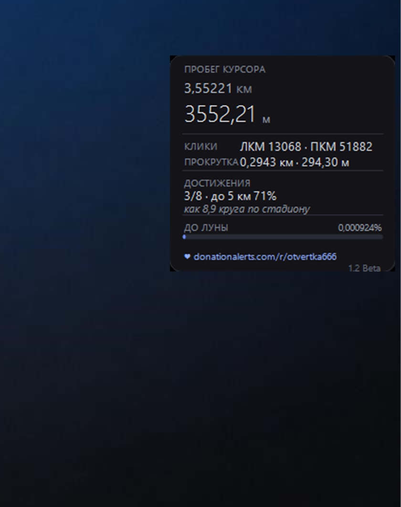

# Mouse Odometer

A tiny Windows widget that counts how far your mouse has travelled — on the desktop and in games.

  



## What it shows

- Distance in kilometres and metres
- Left and right click counters
- Scroll wheel distance (5 cm per notch)
- Achievements: 100 m → 500 m → 1 km → 5 km → 10 km → 21.1 km → 42.195 km → 100 km
- Comparisons: a bus, a football field, a stadium lap, a marathon
- A "to the Moon" progress bar (384,400 km)

## Run it

1. Download `Mouse Odometer.exe` from **Releases**.
2. Run it — no installer, no admin rights.
3. Windows 10/11, .NET Framework 4.8 is already included in the OS.

The widget sits on the desktop and never covers your windows. Drag it with the left mouse button.
Right click for the menu: reset, run at startup, language, support, exit.

It tracks the mouse through Raw Input, so movement and clicks are counted even when a game has the cursor locked.
Data lives in `%APPDATA%\MouseOdometer`.

## Language

The interface switches automatically: Russian on Russian Windows, English everywhere else.
You can change it any time in the right-click menu.

## Build from source

```powershell
& "$env:WINDIR\Microsoft.NET\Framework64\v4.0.30319\csc.exe" /target:winexe /codepage:65001 /win32icon:app.ico /out:"Mouse Odometer.exe" MouseOdometer.cs
```

Single file, no NuGet packages, no .NET SDK required — just the C# compiler that ships with Windows.

## Support the project

[donationalerts.com/r/otvertka666](https://www.donationalerts.com/r/otvertka666)

## License

MIT — see [LICENSE](LICENSE).
